# Todo List – React.js

Aplikasi To-Do List (frontend saja) untuk Kuis Praktikum Pengembangan Frontend.
Dibuat dengan **React.js + Vite**, tema warna **pink**, data awal berupa **data dummy**
(belum terhubung ke REST API).

## Fitur

- **Menampilkan tugas** – tabel berisi Judul, Status, Prioritas, Deadline, dan Aksi.
- **Melihat detail tugas** – klik ikon mata untuk membuka halaman `/todo/:id`.
- **Menambah tugas** – tombol *Tambah Todo* membuka formulir modal (dengan validasi).
- **Memperbarui tugas** – tombol *Update* di halaman detail membuka modal berisi data lama.
- **Menghapus tugas** – klik ikon tempat sampah, lalu muncul dialog konfirmasi.
- **Umpan balik** – dialog konfirmasi hapus dan notifikasi (toast) setelah tambah/ubah/hapus.
- **Prioritas otomatis naik** – semakin dekat deadline, prioritas tidak bisa lebih rendah dari batas minimal (lihat tabel di bawah).
- **Overdue** – tugas yang belum selesai dan melewati deadline diberi label `overdue` dan baris berwarna merah muda.
- **Tandai selesai** – tombol centang di daftar atau tombol *Tandai Selesai* di halaman detail; bisa dibatalkan.
- Perubahan langsung tampil tanpa reload karena memakai **React State** (`useState` + Context).

## Aturan prioritas berdasarkan deadline

| Sisa waktu ke deadline | Prioritas yang boleh dipilih |
| --- | --- |
| Lebih dari 3 hari | low, medium, atau high (bebas) |
| H-3 sampai H-1 | minimal medium |
| Hari H | minimal high |
| Sudah lewat (belum selesai) | ditampilkan sebagai **overdue** |

- Aturan berlaku saat menambah/mengubah tugas (pilihan prioritas di bawah batas dinonaktifkan dan otomatis dinaikkan).
- Untuk tugas lama, prioritas dihitung ulang setiap hari tanpa mengubah data aslinya, jadi `low` bisa tampil sebagai `medium` atau `high` (diberi tanda ↑).
- Tugas berstatus `done` tidak dinaikkan dan tidak dianggap overdue.
- Logika ada di `src/utils/deadline.js`; batas H-3 diubah lewat `MEDIUM_THRESHOLD_DAYS`.

## Struktur data tugas

```js
{
  id: 1,
  title: "REST API dengan Express.js",
  description: "...",
  priority: "low",        // low | medium | high (pilihan pengguna)
  deadline: "2026-11-26", // YYYY-MM-DD
  status: "to-do"         // to-do | in progress | done
}
```

Struktur ini sudah mengikuti atribut pada endpoint `/api/todos`, sehingga mudah
diintegrasikan dengan REST API pada pertemuan berikutnya
(cukup mengganti fungsi di `src/context/TodoContext.jsx` dengan pemanggilan API).

## Struktur folder

```
src/
├── components/   ConfirmDialog, Icons, TodoModal, Toast
├── context/      TodoContext.jsx   (state & operasi CRUD)
├── data/         dummyTodos.js     (data dummy materi Pemweb sem 3)
├── utils/        deadline.js       (prioritas otomatis, overdue, label hari)
├── pages/        TodoList.jsx, TodoDetail.jsx
├── App.jsx
├── main.jsx
└── index.css
```

## Cara menjalankan

```bash
npm install
npm run dev
```

Buka http://localhost:5173 di browser.

Build produksi: `npm run build`.

## Screenshot

## Screenshot

### Tampilan Awal
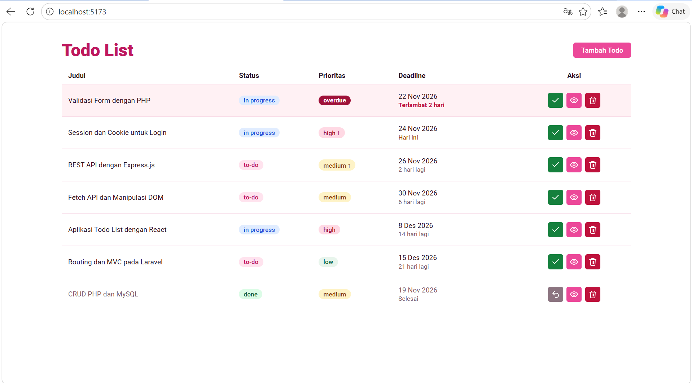

### Tambah Todo
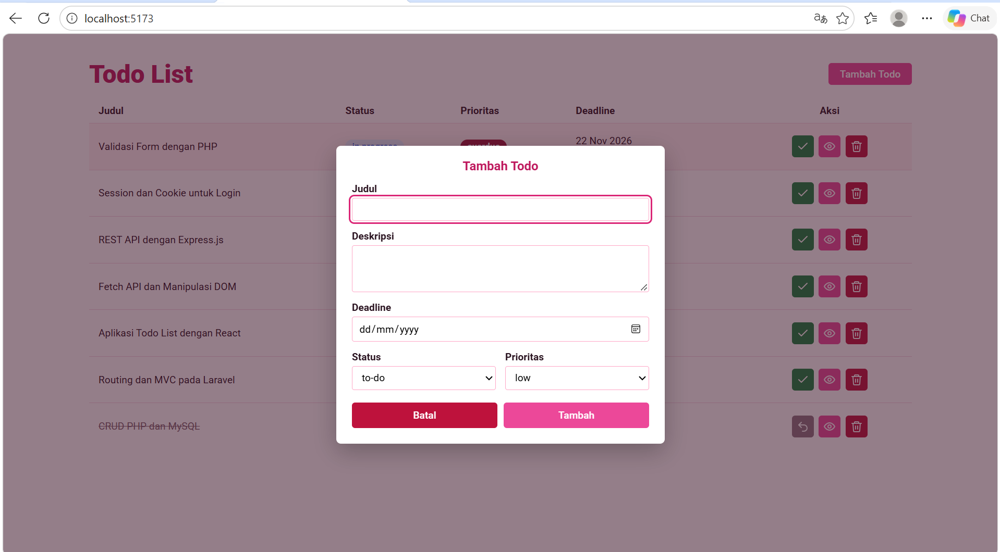
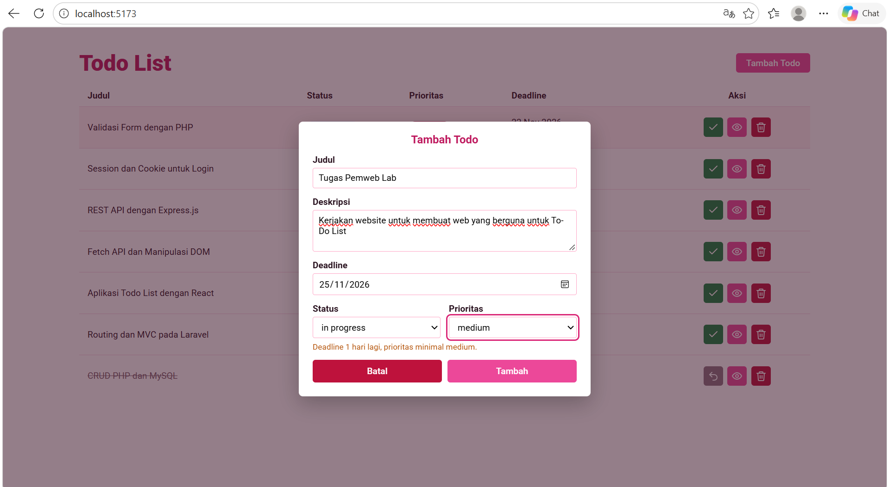
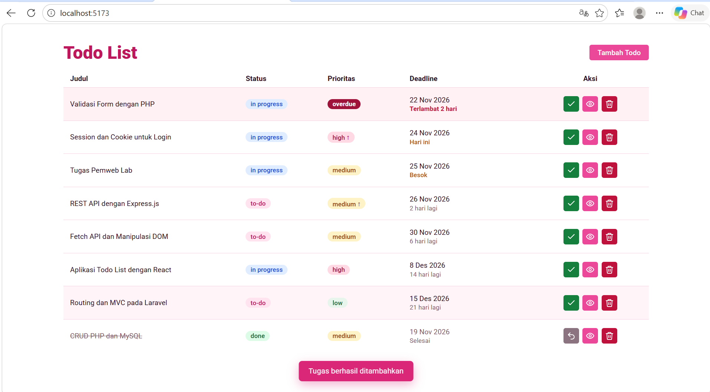

### Update
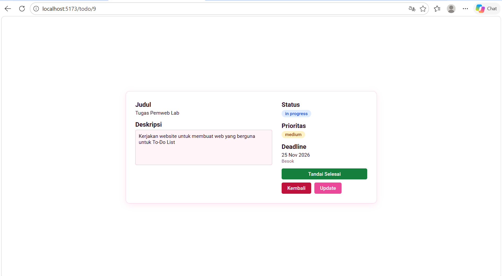
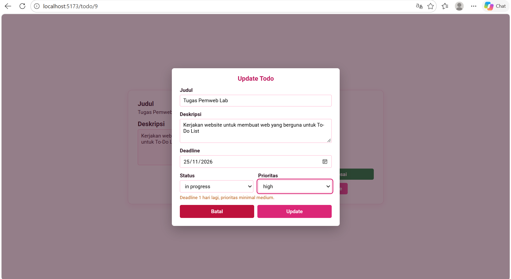
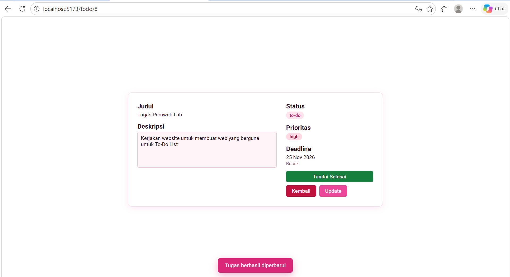
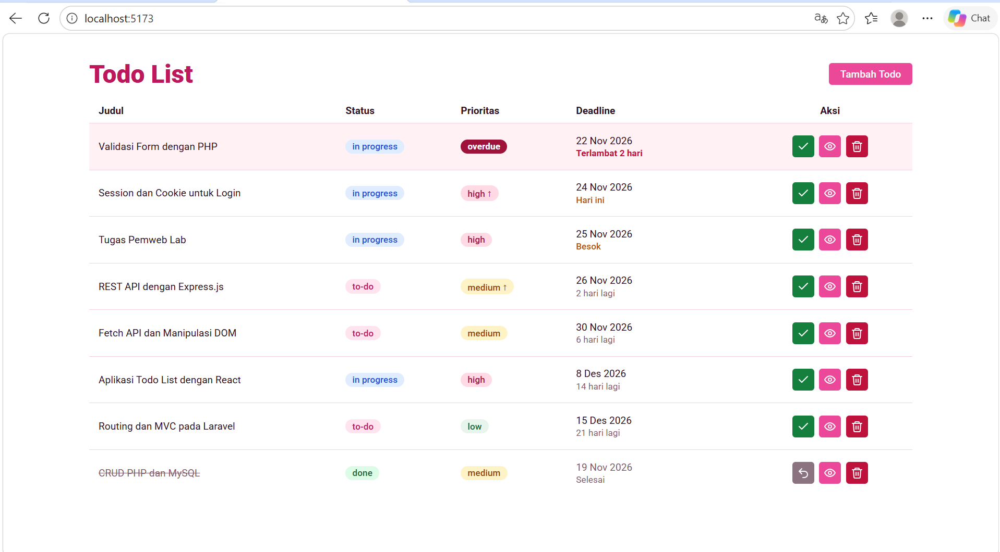

### Tandai Selesai
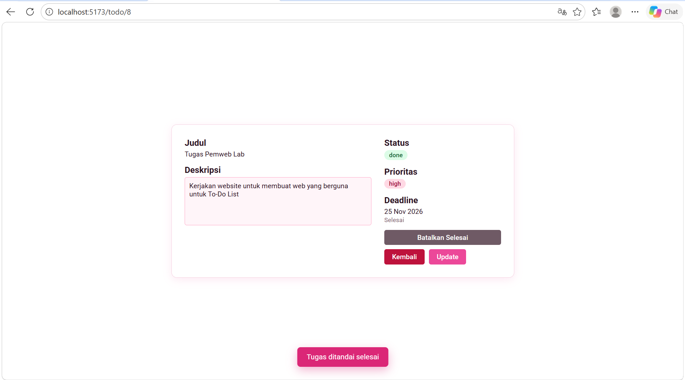
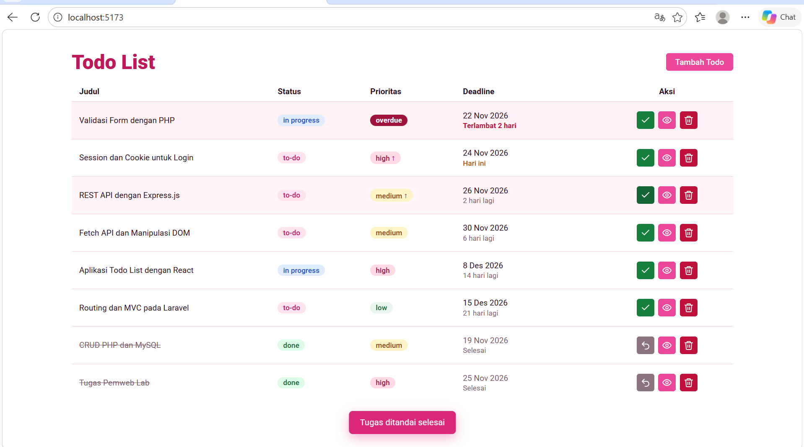

### Batalkan Selesai
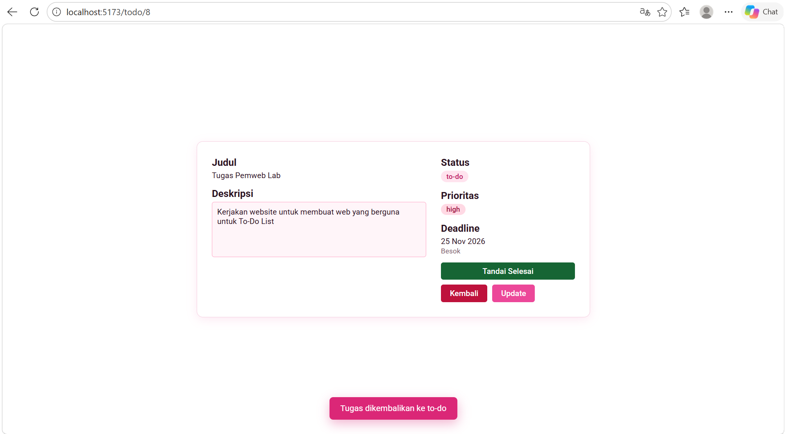
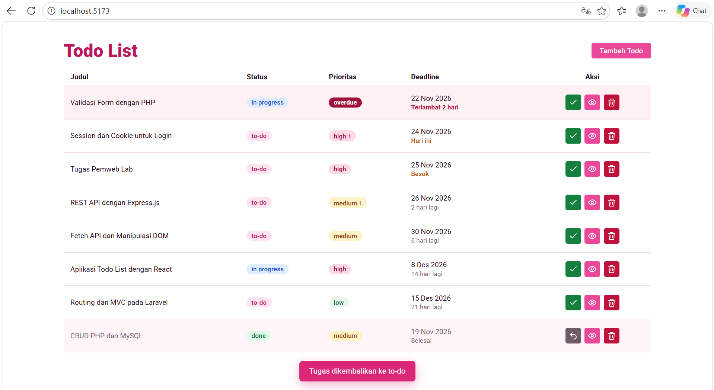

### Hapus
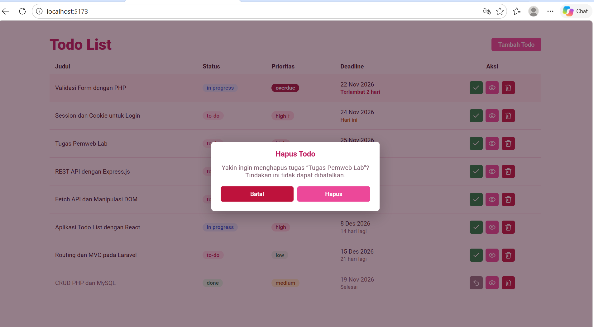
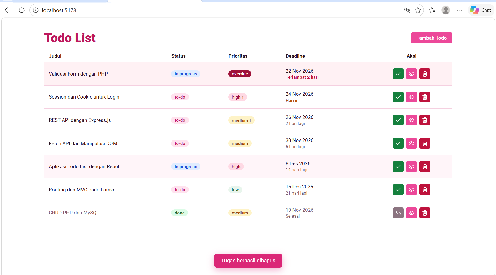

### Contoh Lainnya
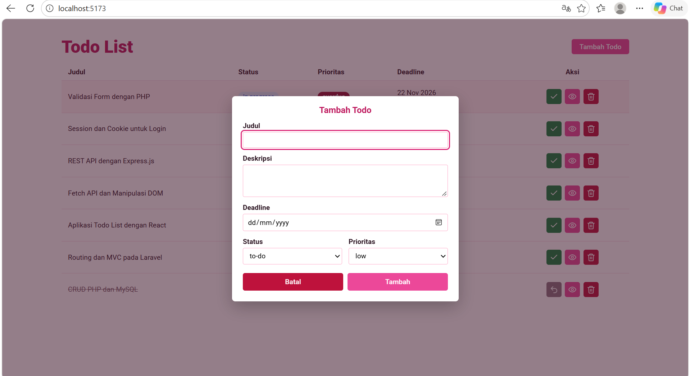
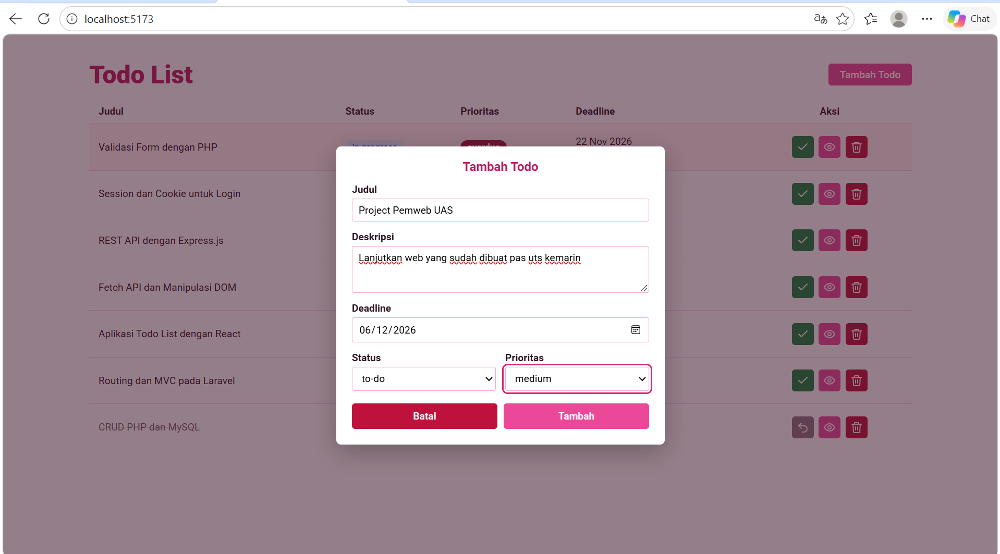
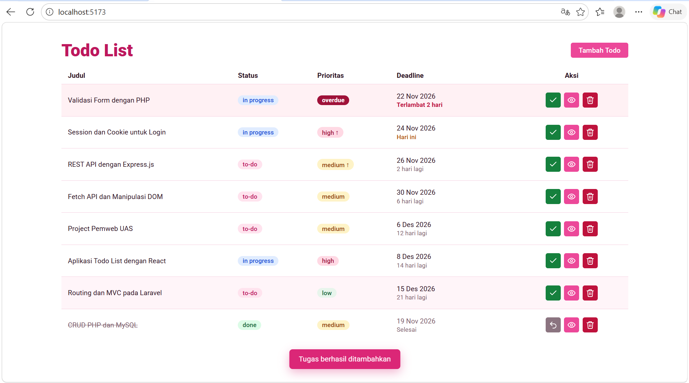
